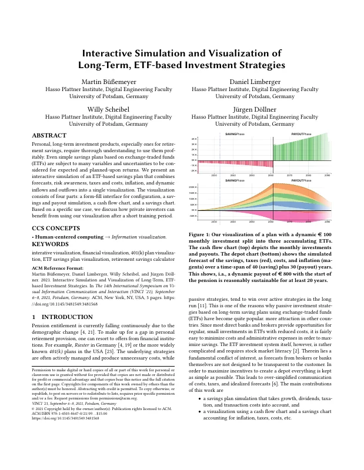
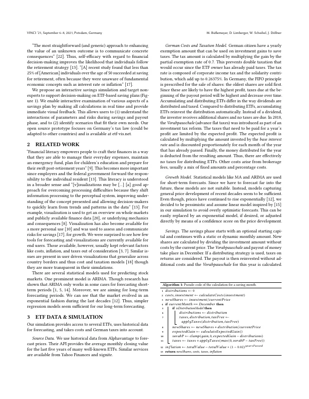
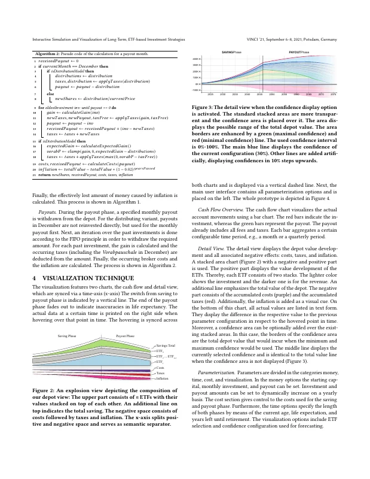
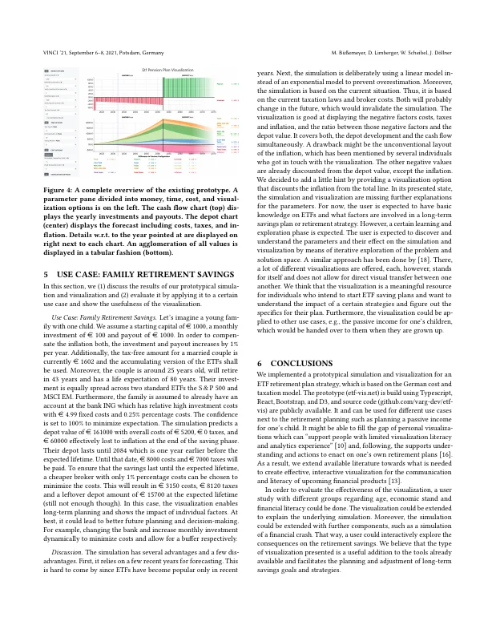
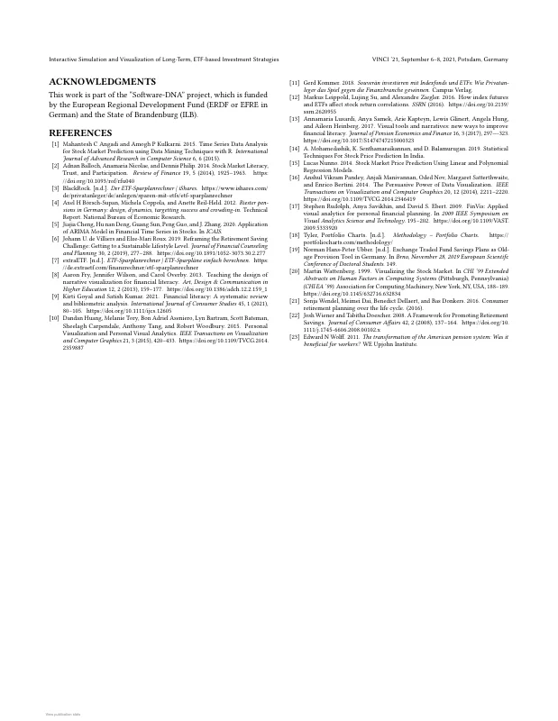

# Interactive Simulation and Visualization of Long-Term, ETF-based Investment Strategies

Martin Büßemeyer, [Daniel Limberger](https://orcid.org/0000-0002-9111-4809), [Willy Scheibel](https://orcid.org/0000-0002-7885-9857), and [Jürgen Döllner](https://orcid.org/0000-0002-8981-8583)

*Proceedings of the 14th International Symposium on Visual Information Communication and Interaction (VINCI '21)*, September 6–8, 2021, Potsdam, Germany. ACM.

DOI: [10.1145/3481549.3481568](https://doi.org/10.1145/3481549.3481568) · Author's version: [Zenodo](https://doi.org/10.5281/zenodo.24099600) · [ResearchGate](https://www.researchgate.net/publication/354332166)

> Personal, long-term investment products, especially ones for retirement savings, require thorough understanding to use them profitably.
> Even simple savings plans based on exchange-traded funds (ETFs) are subject to many variables and uncertainties to be considered for expected and planned-upon returns.
> We present an interactive simulation of an ETF-based savings plan that combines forecasts, risk awareness, taxes and costs, inflation, and dynamic inflows and outflows into a single visualization.
> The visualization consists of four parts: a form-fill interface for configuration, a savings and payout simulation, a cash flow chart, and a savings chart.
> Based on a specific use case, we discuss how private investors can benefit from using our visualization after a short training period.

<p><a href="buessemeyer2021-etf-visualization-as-submitted.pdf"></a> <a href="buessemeyer2021-etf-visualization-as-submitted.pdf"></a> <a href="buessemeyer2021-etf-visualization-as-submitted.pdf"></a> <a href="buessemeyer2021-etf-visualization-as-submitted.pdf"></a></p>
<details><summary>All 5 pages</summary><p><a href="buessemeyer2021-etf-visualization-as-submitted.pdf"></a></p></details>

## Contents

- [`src/`](src/) – LaTeX sources of the camera-ready version (ACM `acmart` v1.67, sigconf)
- [`buessemeyer2021-etf-visualization-as-submitted.pdf`](buessemeyer2021-etf-visualization-as-submitted.pdf) – camera-ready PDF (author build of 2021-08-18)
- [`build.sh`](build.sh) – reproducible build with TeX Live 2020 (podman or docker)
- [`preview/`](preview/) – page previews for this README

## Build

```bash
./build.sh        # → build/etf-visualization.pdf
```

The paper was compiled in August 2021 with pdfTeX 1.40.21 (TeX Live 2020), hence the TeX Live 2020 container.
On `main`, the build produces the revised version (`v1.1-revised`); check out `v1.0-camera-ready` for the camera-ready version.
That build reproduces the camera-ready PDF with identical text, pages, columns, line counts and figure placement.
Only the line breaks inside the bold figure captions on pages 1, 3 and 4 differ slightly (same words and number of lines per caption).

## Versions

- [`v1.0-camera-ready`](https://github.com/dl-archive/article.2021-vinci-etf-visualization/tree/v1.0-camera-ready) – sources as submitted to ACM (2021-08-18)
- [`v1.1-revised`](https://github.com/dl-archive/article.2021-vinci-etf-visualization/tree/v1.1-revised) – author's revised version (2026-11-10): grammar fixes and two leftover sentence fragments, see [Revisions](#revisions)

## Revisions

`v1.1-revised` (2026-11-10) corrects errors in the camera-ready version without changing its content or layout.
Every page carries the note "Author's revised version (2026-11-10). Version of record: https://doi.org/10.1145/3481549.3481568".

- Leftover sentence fragments: "have become quite popular and gain more attraction in other countries" (was "… popular. more attraction in other countries."), stray "for growth." removed (Related Work).
- Tax: "composed of capital gains tax and the solidarity contribution, which add up to 26.375%" (was "corporate income tax … 0.26375%"; German flat-rate capital gains tax 25% plus 5.5% solidarity surcharge on it, as implemented in etf-vis).
- Grammar and word choice: "interactive visualization" (keywords), "passive strategies tend", "to create a depot, everything", "open-source", "an overview of", "user-driven", "However, research has shown", "Yahoo Finance and Xignite", "German citizens", "Even though prices", "a linear model", "(x-axis).", "with respect to", "divided into", "control over the costs", "life expectancy" (2×), "compensate for inflation, both the investment and payout increase", "two standard ETFs: the", "relatively high", "one year before", "increasing the monthly investment", "w.r.t. the year … displayed right next to", "covers both the", "has been taken by", "certain strategies", "is built using TypeScript, …, and its source code … is publicly available", "It can be used", "consequently, support", "economic status".
- PDF metadata: title with a space between "of" and "Long-Term".

## Citation

```bibtex
@InProceedings{buessemeyer2021-etf-visualization,
  author    = {B{\"u}{\ss}emeyer, Martin and Limberger, Daniel and Scheibel, Willy and D{\"o}llner, J{\"u}rgen},
  title     = {Interactive Simulation and Visualization of Long-Term, ETF-based Investment Strategies},
  booktitle = {Proceedings of the 14th International Symposium on Visual Information Communication and Interaction},
  year      = {2021},
  series    = {VINCI~'21},
  publisher = {ACM},
  doi       = {10.1145/3481549.3481568},
  isbn      = {978-1-450386-47-0},
}
```
